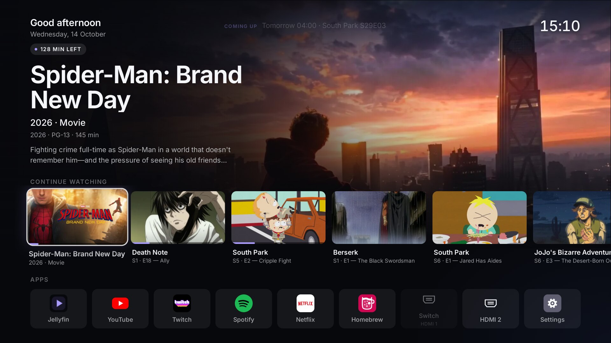
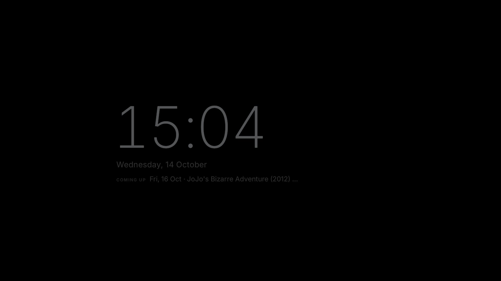

# Minimal Home

A clean, one-page home screen for rooted LG webOS TVs: Jellyfin "continue watching" with big artwork, tiles for the
apps you actually use, an OLED-friendly idle screen, and a small helper that makes the Home key, Back and power-on go
straight to it (no flash of LG's own launcher).

It pairs with [Jellyfin Native](https://github.com/SchulzCode/WebOS-Jellyfin-Native), a native Jellyfin client: a press on a card plays the
episode there, from where you left off.

Unofficial; not affiliated with LG or the Jellyfin project. Tested on one TV, see [Tested on](#tested-on).



## Features

- **Continue watching** from Jellyfin (resume, recently started, next up). OK on a card plays it in Jellyfin Native at
  the resume position.
- **App tiles** for the apps installed on the TV (YouTube, Netflix, Spotify, Twitch, Homebrew, Settings, …) and the
  HDMI inputs, which show the input name and dim when nothing is switched on. **Rearrange them**: hold OK on a tile
  to pick it up, ◀ ▶ to move it (the others slide aside), OK to place it, Back to cancel; with the pointer, hold the
  button and drag. The order is remembered.
- **OLED idle screen** after 60 s without input: true black with a thin, dim clock that moves every minute; panel off
  after 30 minutes. LG's own screensaver is switched off only while the launcher or Jellyfin Native (which has its own
  idle screen) is in front.

  

- **Boots straight onto the launcher** and is the system Home: the Home key and Back from an app land on it.
- Magic Remote pointer support.
- Optional: a **"Downloading / Coming up" line** at the top from Sonarr + Radarr: what is downloading right now
  (progress and time left, counting down live), downloads that need a look ("Download problem", e.g. a fake release
  Sonarr refuses to import), and what airs or releases in the next days. It comes from a small feed service on your
  server, see [Sonarr/Radarr feed](#sonarrradarr-feed-optional).

## Sonarr/Radarr feed (optional)

`server/launcher-feed/` is a tiny service (Python standard library only, one Docker container) that runs next to
Sonarr and Radarr and summarises them for the TV, so the TV never holds their API keys. Minimal Home uses it for the
line at the top; [Jellyfin Native](https://github.com/SchulzCode/WebOS-Jellyfin-Native) uses it for its "Downloading"
row, the media storage panel and (if you allow it) deleting.

| endpoint | what |
|---|---|
| `GET /feed` | what is downloading (one entry per download - a season pack is one entry - with state, progress, time left and artwork links) and what airs/releases in the next 7 days |
| `GET /art/<sonarr\|radarr>/<id>/<fanart\|fanart-360\|poster-500\|clearlogo>` | the artwork Sonarr/Radarr already cached |
| `GET /storage` | free and total space of the disks behind the root folders, and whether deleting is switched on |
| `GET /manage/item`, `POST /manage/delete` | only with `ALLOW_DELETE=1`: what deleting a film or a whole series would remove, and the delete itself |
| `GET /health` | `ok` |

Sonarr and Radarr only ask the download client for news about once a minute, so the feed estimates progress and time
left for the moment it is asked; the launcher asks every 20 s while something downloads (otherwise every 10 minutes)
and counts down in between.

**Setup**: fill in the `SERVER_*`, `FEED_BIND` and `ARR_NETWORK` lines in `config.env`, then run
`server/launcher-feed/deploy.sh` (or `scripts/rebuild-all.sh --with-feed`). It copies the service to the server, reads
the Sonarr/Radarr API keys there from their own `config.xml` straight into `feed.env` (mode 0600, never printed) and
starts the container, bound to the server's LAN address only. Then point the launcher at it with `VITE_FEED_URL`
(see [Install](#install)); Jellyfin Native finds it by itself on the Jellyfin server's host, port 8091.
If Sonarr/Radarr aren't reachable as `http://sonarr:8989` / `http://radarr:7878` on that network, add `SONARR_URL` /
`RADARR_URL` to `feed.env`.

**Deleting from the TV** (off by default): `FEED_ALLOW_DELETE=1` in `config.env`, then deploy again. Jellyfin Native
then shows a delete button on films and series. The service deletes through Sonarr/Radarr (files included, and they
stop downloading it), because Jellyfin usually has the media read-only and Sonarr would just fetch it again. It only
acts for a **Jellyfin administrator**: the app sends its own Jellyfin sign-in, the service checks it with Jellyfin
(`http://jellyfin:8096` on the same network, or `JELLYFIN_URL` in `feed.env`), matches the title by folder (by
TVDB/TMDB id only when no folder matches, and never when more than one title matches), and deletes only the exact
Sonarr/Radarr entry the confirmation dialog showed. Every delete is written to the container log.

## Tested on

Developed and tested on one TV; other models are untested. If it works (or doesn't) on yours, please open an issue.

| | |
|---|---|
| TV | LG OLED55B4ELA (OLED B4, 2024, EU) |
| Firmware | 33.31.75 |
| webOS | webOS TV 25 (webOS 10.3.2, board K24) |
| Root / homebrew | rooted, Homebrew Channel 0.7.3, SSH on |
| Jellyfin server | 12.2.0 |

## Requirements

- An LG webOS TV that is **rooted**, with the [Homebrew Channel](https://github.com/webosbrew/webos-homebrew-channel)
  and SSH enabled in its settings. Making it the system Home and starting at boot needs root.
- A Jellyfin server with Quick Connect enabled (Dashboard → General), and [Jellyfin Native](https://github.com/SchulzCode/WebOS-Jellyfin-Native)
  installed for playback.
- A Linux/macOS computer on the same network with SSH key access to the TV (for the one-time setup).

## Install

```sh
cp config.example.env config.env        # the TV's address and your SSH key
# 1. install the app: the .ipk from Releases via the Homebrew Channel / ares-install, or build it: scripts/rebuild-all.sh
# 2. one-time setup on the TV (helper, boot hook, Home default):
scripts/rebuild-all.sh --setup
```

Releases: https://github.com/SchulzCode/WebOS-Minimal-Launcher/releases

On first start the launcher asks for your Jellyfin server (taken over from Jellyfin Native automatically if that is
already signed in), then shows a Quick Connect code to approve in any signed-in Jellyfin app.

Building from source: Node 20+ and `ares-package` (`npm i -g @webos-tools/cli`). `scripts/rebuild-all.sh` builds,
packages, installs and sets everything up; `--help` lists the steps. A server to suggest at sign-in and the optional
feed URL can be set at build time in `app/.env.local` (git-ignored; `RELEASE=1 scripts/rebuild-all.sh --only build`
ignores it, for packages you publish):

```sh
VITE_JELLYFIN_URL=https://jellyfin.example.com
VITE_FEED_URL=http://192.168.1.20:8091/feed
VITE_HDMI_NAMES={"HDMI_1":"Game console"}   # or rename the input on the TV itself, which wins
```

## Updating

Install the new `.ipk`, then run `scripts/rebuild-all.sh --setup` again: the installer stops the helper, and its
root-only copy has to be refreshed from the new package. (A full `scripts/rebuild-all.sh` does both.)

## Uninstall

`scripts/uninstall.sh` shows what it would undo; `scripts/uninstall.sh --yes` does it: Home default back to LG's Home,
LG's screensaver on, boot hook and helper removed, app uninstalled. Don't just delete the app without it: the Home key
would do nothing until the helper's safeguard notices (it resets the Home default within a few minutes).

## What it changes on the TV

| what | why | undone by |
|---|---|---|
| `general.defaultApps.home` → the launcher | Home key opens it directly | `uninstall.sh` |
| `general.screenSaverEnabled` off while the launcher or Jellyfin Native is in front, on otherwise | their own idle screens replace LG's | `uninstall.sh` / any other app in front |
| `general.lastInputApp` / `physicalLastInputApp` kept on the launcher | power-on lands on it, not on HDMI | next input change |
| `/var/lib/webosbrew/init.d/50-minimalhome` + `/var/lib/webosbrew/minimalhome-helper/` | starts the helper at boot | `uninstall.sh` |

Optional (`--with-telemetry-block`): a boot hook that blocks LG's ad and telemetry hosts (`tv-hooks/`).
Optional (`--with-no-voice`): a boot hook that switches off voice input, so the Magic Remote's microphone does nothing
(`tv-hooks/61-no-voice`; the B4 has no built-in microphones or camera).

## Security

- The helper runs as root (it reads the remote's input device and changes system settings). It runs from a root-only
  copy in `/var/lib/webosbrew/minimalhome-helper/` and refuses to start from anywhere writable by others: app folders
  on webOS are world-writable, so running root code from there would let any app take over the TV.
- The helper's bus methods only do fixed things (status, launch Jellyfin Native with a validated item id, list
  installed app ids, turn the panel off while the launcher is in front, report Jellyfin Native's server address - never
  its token). No shell is ever involved.
- The Jellyfin access token lives in the launcher's own storage on the TV; no password is entered or stored.
- The feed service holds the Sonarr/Radarr keys on the server; the TV never sees them. It listens only on the server's
  LAN address, runs as a non-root user in a read-only container without capabilities, and answers only GET requests -
  except the optional delete, which needs a Jellyfin administrator's sign-in. That sign-in travels over plain HTTP on
  your LAN (like the rest of the feed), so only switch deleting on in a network you trust.

## Layout

| path | what |
|---|---|
| `app/` | the launcher (Vite, React API bundled with Preact), `tld.my.minimalhome` |
| `app/service/` | the helper service `tld.my.minimalhome.service` (Node, runs as root) + its boot script |
| `scripts/` | `rebuild-all.sh` (build/install/setup), `uninstall.sh` |
| `server/launcher-feed/` | optional Sonarr/Radarr feed (Docker): downloads, upcoming, artwork, storage, optional delete |
| `tv-hooks/` | optional telemetry host block, optional voice/microphone off |
| `tools/` | SSH wrappers (`tv`, `tvt`) and a DevTools client (`cdp.mjs`) for development |

## License

[0BSD](LICENSE): do anything you like with it, no attribution needed. The app logos in `app/public/icons/` (Netflix,
Twitch, Jellyfin, …) belong to their owners and are not covered by this license; they are only there so the tiles look
like the apps they open. Inter is under the SIL Open Font License. The film and series artwork in the screenshots (`docs/screenshots/`) belongs to its rights holders and is only shown to illustrate the app.
